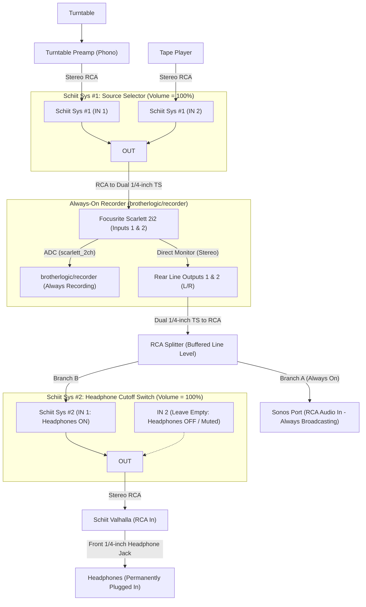

# Office Hi-Fi Routing Solution

## 1. Root Cause Diagnosis (Why the Current Setup Had Issues)

Your previous signal chain was:

```text
[Turntable -> Phono Preamp] / [Tape Player]
  -> Schiit Sys #1
  -> Schiit Valhalla (RCA In -> Rear RCA Preamp Out)
  -> Passive RCA Splitter
       ├── Headphones (via RCA adapter)
       └── Focusrite Scarlett 2i2 (Recorder) -> Scarlett Line Out -> Sonos Port
```

This topology created three interacting electrical issues:

1. **Auto-Mute Workaround Forced Headphones onto the Rear RCA Preamp Outputs:**
   On the Schiit Valhalla, plugging headphones into the front `1/4"` headphone jack triggers a mechanical switch that **automatically mutes the rear RCA Preamp Outputs**—which cut off audio to the Scarlett (`brotherlogic/recorder`) and Sonos Port.
2. **Gain Shifts When Unplugging Headphones:**
   The Valhalla is an OTL (Output Transformerless) tube amplifier whose rear RCA Preamp Outputs include series protection resistors designed for high-impedance line inputs ($\ge 10\text{ k}\Omega$), not low-impedance headphones ($32\text{--}300\text{ }\Omega$). Putting headphones and the Scarlett in parallel on the rear RCA outputs created a heavy voltage divider across the tube output stage. Unplugging the headphones removed that load, causing the output voltage (gain) into the Scarlett and Sonos Port to jump significantly.
3. **Headphone Bleed-Through When Listening on Sonos:**
   Because the Scarlett and Sonos Port were *downstream* of the Valhalla, the Valhalla had to remain powered on with its volume knob turned up just to feed line-level audio to the recorder and Sonos—causing the headphones to play out loud into the room.

---

## 2. Recommended Architecture (Always Record + Always Broadcast on Sonos + Switchable Headphones)

To support **Sonos + Headphones simultaneously** *and* still have a **hard one-button cutoff for the headphones**:
1. Place the **Focusrite Scarlett 2i2 (`brotherlogic/recorder`)** immediately after `Schiit Sys #1`.
2. Split the **Scarlett 2i2 Rear Line Outputs** (which are actively buffered low-impedance line outputs, $\sim 100\text{ }\Omega$) into two high-impedance line branches:
   - **Branch A (Always On):** Directly into the **Sonos Port RCA Audio In** so Sonos is *always* receiving audio.
   - **Branch B (Switched Headphone Cutoff):** Into **`Schiit Sys #2` (`IN 1`)**, with **`IN 2` left empty** as a dead-mute position, and **`OUT`** feeding the **Schiit Valhalla RCA In**.

### Plain-Text Signal Chain

```text
[Turntable -> Turntable Preamp] ──> (IN 1) ┐
                                           ├──> Schiit Sys #1 (Vol: 100%)
[Tape Player] ────────────────────> (IN 2) ┘          │
                                                      ▼ (OUT -> RCA to Dual 1/4" TS)
                                      Focusrite Scarlett 2i2 (Inputs 1 & 2)
                                        ├──> ADC (scarlett_2ch) -> brotherlogic/recorder (ALWAYS ON)
                                        └──> Stereo Direct Monitor -> Rear Line Outputs 1 & 2
                                                                            │
                                                                            ▼ (Dual 1/4" TS to RCA)
                                                                      RCA Splitter
                                                                       ├──> Branch A (Always On) ──> Sonos Port (RCA In)
                                                                       └──> Branch B (Switched)  ──> Schiit Sys #2 (IN 1)
                                                                                                       ├── (IN 2 left empty = MUTE)
                                                                                                       └── (OUT, Vol: 100%)
                                                                                                             │
                                                                                                             ▼
                                                                                                   Schiit Valhalla (RCA In)
                                                                                                             │
                                                                                                             ▼ (Front 1/4" Jack)
                                                                                                        Headphones
```

### Mermaid Diagram



### Why Splitting Here Does Not Change Gain (and Why Sonos Volume Stays Full)
1. **No Low-Impedance Loading:** In your old setup, the RCA splitter was on the Valhalla's tube output driving low-impedance headphones ($32\text{--}300\text{ }\Omega$). That heavy load dragged down the voltage on the RCA line, making it seem like the Valhalla had to be cranked up to feed the rest of the chain. Here, the splitter sits on the Scarlett's actively buffered solid-state line output ($\sim 100\text{ }\Omega$) and drives two **high-impedance line inputs** (`Sonos Port` $\sim 20\text{ k}\Omega$ and `Valhalla RCA In` $50\text{ k}\Omega$). Toggling `Schiit Sys #2` on or off changes the load on the Scarlett's line buffer by less than **$0.02\text{ dB}$** (completely inaudible), and `brotherlogic/recorder` captures from the ADC *upstream* of the split so recording gain is $100\%$ untouched.
2. **Plenty of Line Level Without the Valhalla:**
   - Your **Turntable Preamp** and **Tape Player** already output standard consumer line level ($\sim 0.5\text{--}2.0\text{ V}_{\text{rms}}$), and `Schiit Sys #1` at 100% volume passes that at unity gain ($0\text{ dB}$ loss).
   - In your previous topology (`Valhalla -> Scarlett -> Sonos`), **the Scarlett 2i2 was already what drove the Sonos Port**. The Scarlett is an active audio interface with its own input preamps and active line output stage (capable of up to $+10\text{ dBu} \approx 2.45\text{ V}_{\text{rms}}$ unbalanced out—hotter than standard consumer RCA line level).
   - If Sonos ever needs more or less level, you have three independent places to trim it without touching headphone volume:
     1. **Scarlett Input 1 & 2 Gain Knobs** (sets recording level for `brotherlogic/recorder` and feeds the Direct Monitor bus).
     2. **Scarlett Front `Monitor` Knob** (controls the output level of Rear Line Outputs 1 & 2 feeding Sonos and the Valhalla).
     3. **Sonos App `Source Level` Setting** (`Settings -> System -> Sonos Port -> Source Level`, adjustable from Level 1 to Level 10).

> [!TIP]
> **Splitter-Free Alternative Using the Scarlett's Front `1/4"` Jack:**
> The Scarlett 2i2 4th Gen has two independently buffered stereo monitor outputs that both receive the Stereo Direct Monitor mix:
> - **Rear Line Outputs 1 & 2** $\rightarrow$ directly to **Sonos Port RCA In** (always on).
> - **Front `1/4"` TRS Output** (via a `1/4"` TRS to dual RCA cable) $\rightarrow$ **`Schiit Sys #2 IN 1`** $\rightarrow$ **Valhalla RCA In**.
> Either method (reusing your existing RCA splitter on the rear outputs, or using the front `1/4"` output for the headphone branch) keeps Sonos and the Recorder always active with zero gain interaction.

---

## 3. Step-by-Step Wiring Guide

### Step 1: Source Selection (`Schiit Sys #1` — Standard 2-In, 1-Out Mode)
- **`IN 1` (RCA):** Connect from your **Turntable Preamp** output.
- **`IN 2` (RCA):** Connect from your **Tape Player** line output.
- **`OUT` (RCA):** Connect to **Focusrite Scarlett 2i2 Inputs 1 & 2** using a stereo RCA to dual `1/4"` TS cable (or RCA cable with `1/4"` TS adapters).
- **Volume Knob:** Set to **100% (fully clockwise)** so your recorder always receives full, unattenuated line level.

### Step 2: Always-On Recorder (`Focusrite Scarlett 2i2 4th Gen`)
- **Input Configuration:** Ensure Inputs 1 & 2 are in **Line** mode (neither `Inst` nor `Air` enabled) with matched gain halos so `brotherlogic/recorder` (`arecord --device scarlett_2ch`) captures a clean stereo signal.
- **Direct Monitoring:** Press the **Direct** button on the front of the Scarlett 2i2 until the **Stereo Direct Monitor icon `((O))`** is lit. This passes Inputs 1 & 2 directly to the outputs with zero latency and keeps Input 1 panned Left and Input 2 panned Right.
- **Rear Line Outputs `1 (L)` & `2 (R)`:** Connect your **existing RCA splitter** here:
  - **Branch A:** Connect directly to **Sonos Port RCA Audio In**.
  - **Branch B:** Connect to **`Schiit Sys #2 IN 1`**.
- **Main Monitor Knob:** Set the large **Monitor** knob on the Scarlett front panel to a fixed unity/line-level position (~2–3 o'clock) and leave it there.

### Step 3: Headphone Cutoff Switch (`Schiit Sys #2` — Standard Forward Mode)
Because `Schiit Sys #2` now sits strictly on the headphone branch as an inline cutoff switch, it runs in **normal forward mode**:
- **`IN 1` Jack:** Connected from Branch B of the Scarlett output splitter (**Headphones ON**).
- **`IN 2` Jack:** **Leave unconnected** (**Headphones OFF / Cut Off**).
- **`OUT` Jack:** Connect via stereo RCA cable to **Schiit Valhalla RCA In**.
- **Volume Knob:** Keep at **100% (fully clockwise)** and control headphone volume on the Valhalla.

### Step 4: Headphone Amplifier (`Schiit Valhalla`)
- **Leave the Valhalla Rear RCA Preamp Outputs completely empty.**
- **Plug your headphones directly into the Valhalla's front `1/4"` headphone jack** and leave them plugged in permanently.
- Control headphone listening volume with the Valhalla's front volume knob.

---

## 4. Hardware & Cable Checklist

| Item | Status | Role |
| :--- | :--- | :--- |
| **Schiit Sys #1** | Existing | Switches between Turntable Preamp (`IN 1`) and Tape Player (`IN 2`) |
| **Focusrite Scarlett 2i2 4th Gen** | Existing | Captures audio for `brotherlogic/recorder` and buffers line out via Stereo Direct Monitor |
| **RCA Splitter** | Existing | Splits buffered Scarlett line output to Sonos Port (always on) and `Schiit Sys #2` |
| **Schiit Sys #2** | **Add (1x)** | Inline cutoff switch on the headphone branch (`IN 1` = Headphones On, `IN 2` = Muted) |
| **Schiit Valhalla** | Existing | Drives headphones from its front `1/4"` jack (rear RCA outputs left empty) |
| **Sonos Port** | Existing | Always receives line-in audio from Branch A of the Scarlett output split |
| **Stereo RCA Cable (1x extra)** | Check stock | Connects `Schiit Sys #2 OUT` to `Valhalla RCA In` |

---

## 5. How Daily Operation Works

| Mode | `Schiit Sys #2` Position | Recorder (`brotherlogic/recorder`) | Sonos Port | Headphones (Valhalla) |
| :--- | :--- | :--- | :--- | :--- |
| **Sonos + Headphones Together** | **`IN 1`** | Recording | Broadcasting | **Active** |
| **Sonos Only (No Headphone Bleed)** | **`IN 2` (Empty)** | Recording | Broadcasting | **Hard Cut Off (Muted)** |
